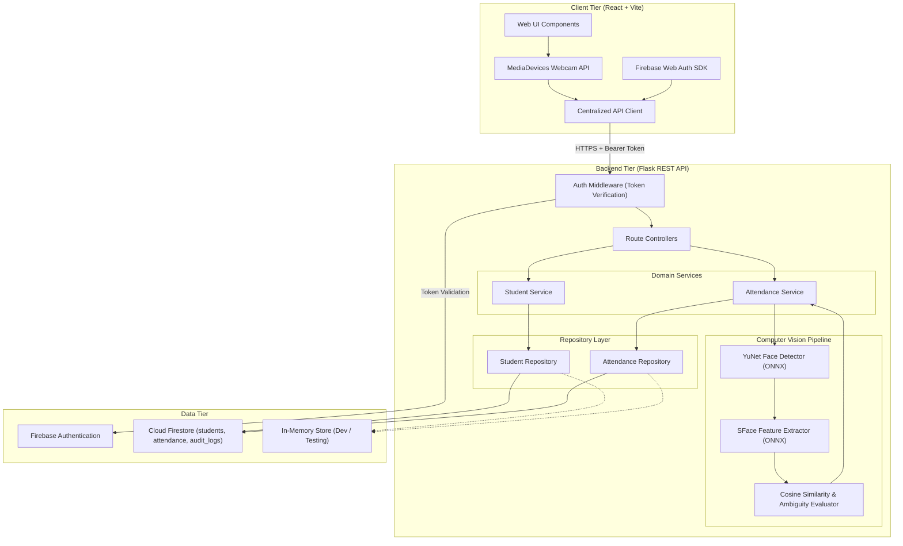
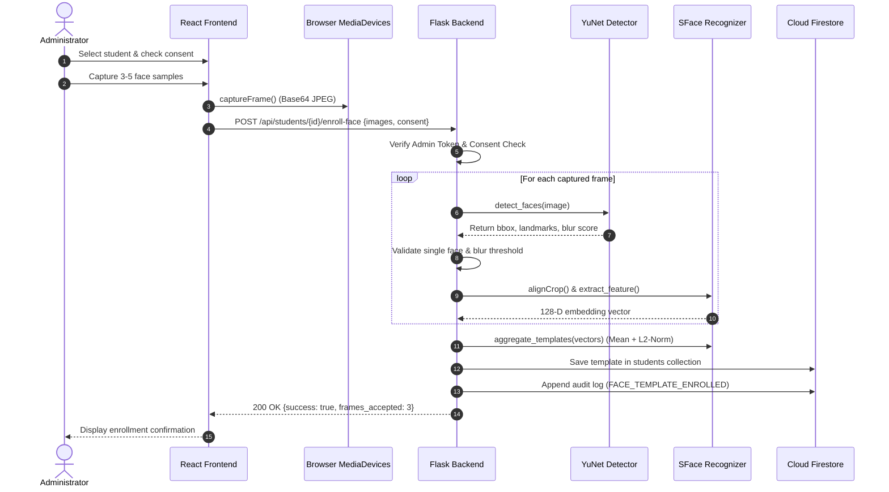
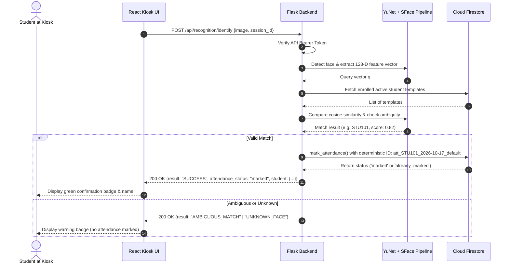

# System Architecture & Technical Design

This document details the software architecture, computer vision pipeline, biometric data handling policies, and concurrency control for the **Student Attendance Management System with Face Recognition**.

---

## 1. High-Level Architecture

The system follows a strict **N-Tier Client-Server Architecture** with dependency separation. The browser client is responsible only for video capture and user presentation; all authoritative biometric decisions and attendance record commits are executed exclusively on the backend.

---

## 2. Computer Vision Pipeline (YuNet + SFace)

Unlike simplistic systems that conflate face detection with identity recognition, this application separates the computer vision task into two distinct, specialized deep learning models:

### Phase 1: Face Detection & Landmark Extraction (YuNet)
- **Model**: `face_detection_yunet_2023mar.onnx`
- **Architecture**: Lightweight convolutional network optimized for real-time edge face detection.
- **Input**: BGR image matrix $(H \times W \times 3)$.
- **Outputs**:
  - Bounding box coordinates $[x, y, w, h]$.
  - Five facial landmarks: right eye, left eye, nose tip, right mouth corner, left mouth corner.
  - Confidence score $c \in [0, 1]$.
- **Quality Verification**:
  - Minimum bounding box size ($\ge 60 \times 60\text{ px}$).
  - Face count validation (exactly 1 face allowed during enrollment).
  - Blur detection: Computed via the Laplacian variance $\sigma^2$:
    $$\sigma^2 = \text{Var}(\nabla^2 I_{\text{gray}})$$
    Frames with $\sigma^2 < 30.0$ are rejected as motion-blurred.

### Phase 2: Face Alignment & 128-D Feature Extraction (SFace)
- **Model**: `face_recognition_sface_2021dec.onnx`
- **Alignment**: Five facial landmarks are aligned via affine transformation to produce a normalized $112 \times 112\text{ px}$ face crop.
- **Feature Extraction**: Deep CNN generates a 128-dimensional dense floating-point embedding vector $\mathbf{v} \in \mathbb{R}^{128}$.
- **L2-Normalization**:
  $$\hat{\mathbf{v}} = \frac{\mathbf{v}}{\|\mathbf{v}\|_2}$$

### Phase 3: Identity Matching & Ambiguity Resolution
Enrolled students store a pre-calculated template $\mathbf{t}_i \in \mathbb{R}^{128}$. The similarity between the query embedding $\hat{\mathbf{q}}$ and each enrolled template $\hat{\mathbf{t}}_i$ is computed via **Cosine Similarity**:

$$\text{Sim}(\hat{\mathbf{q}}, \hat{\mathbf{t}}_i) = \hat{\mathbf{q}} \cdot \hat{\mathbf{t}}_i = \sum_{k=1}^{128} \hat{q}_k \cdot \hat{t}_{i,k}$$

#### Matching Decision Algorithm:
1. Candidate list is sorted in descending order of similarity: $S_1 \ge S_2 \ge \dots \ge S_n$.
2. **Threshold Test**: If $S_1 < \theta_{\text{sim}}$ (default: $0.380$), return `UNKNOWN_FACE`.
3. **Ambiguity Test**: If a second candidate exists ($S_2$) and $S_2 \ge (\theta_{\text{sim}} - 0.10)$:
   - Compute the confidence margin $\Delta = S_1 - S_2$.
   - If $\Delta < \delta_{\text{margin}}$ (default: $0.080$), flag as `AMBIGUOUS_MATCH` and reject automatic attendance recording.
4. If both tests pass, the identity of student 1 is confirmed and attendance is recorded.

---

## 3. Sequence Diagrams

### A. Face Enrollment Workflow

### B. Live Face Attendance Workflow

---

## 4. Idempotency & Concurrency Design

Duplicate attendance entries for the same student on the same calendar day are prevented through **Deterministic Document Identifiers**:

$$\text{Document ID} = \texttt{att\_\{student\_id\}\_\{attendance\_date\}\_\{session\_id\}}$$

Example: `att_CS202601_2026-10-17_default`

### Atomic Write Guarantees:
- **Cloud Firestore**: Uses `doc_ref.create(record)`, which utilizes an internal precondition requiring that the document does not exist. If two concurrent requests attempt to write simultaneously, one succeeds and the other fails with an `ALREADY_EXISTS` exception, which is caught and converted cleanly to an idempotent `already_marked` response.
- **In-Memory Store**: Uses a `threading.Lock()` mutex around document lookup and insertion to guarantee zero duplicate writes under concurrent execution.

---

## 5. Biometric Data Privacy & Threat Analysis

### Privacy Safeguards
1. **No Raw Image Storage**: Webcam frames submitted to `/api/recognition/identify` and `/api/students/{id}/enroll-face` are processed in memory and discarded. No raw photographs are stored in Firestore or on disk.
2. **Access Control**: Biometric feature vectors are accessible exclusively via backend service account operations. Direct client SDK reads of the `face_template` field are blocked via Firestore Security Rules.
3. **Consent Requirement**: Enrollment strictly requires an explicit consent flag (`enrollment_consent = true`). Deletion endpoints (`DELETE /api/students/{id}/face-template`) allow immediate purge of biometric vectors upon student request.

### Threat Modeling & Attack Surface
- **Presentation Attacks (Spoofing)**: Because the system uses standard 2D webcam video without active infrared illumination, structured light, or depth sensors, **it is vulnerable to high-resolution printed photographs or video replay on smartphones**. In academic and enterprise environments, the system is designed for proctored kiosks where an administrator or teacher supervises check-ins.
- **Adversarial Noise & Lighting Variation**: Changes in ambient lighting or partial occlusions (e.g., masks) are mitigated by multi-sample aggregation and strict blur detection.
- **CSV Formula Injection**: All exported fields are sanitized using `sanitize_csv_cell` to neutralize formula execution (`=`, `+`, `-`, `@`) when opening reports in Microsoft Excel or Google Sheets.
